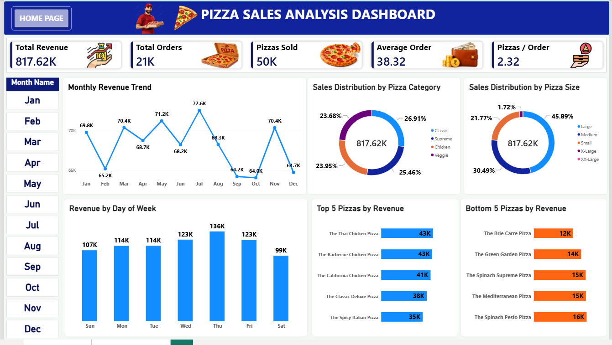

# 🍕 Pizza Sales Analysis Dashboard

## Project Overview

This project analyzes pizza sales using PostgreSQL and Power BI to understand sales performance and trends.

## Tools Used

- PostgreSQL
- Microsoft Power BI
- DAX

## Project Objectives

- Analyze pizza sales.
- Track sales KPIs.
- Understand daily and monthly sales.
- Identify best-selling and least-selling pizzas.
- Compare sales by category and size.

## Key Performance Indicators

- Total Revenue
- Total Orders
- Total Pizzas Sold
- Average Order Value
- Average Pizzas Per Order

## Dashboard Features

- Monthly Revenue Trend
- Sales by Pizza Category
- Sales by Pizza Size
- Daily Sales Trends
- Top 5 Pizzas by Revenue
- Bottom 5 Pizzas by Revenue
- Interactive Month Slicer
- Home Page Navigation

## Project Workflow

1. Imported data into PostgreSQL.
2. Analyzed data using SQL queries.
3. Connected PostgreSQL to Power BI.
4. Created an interactive dashboard.

### Home Page

### Dashboard Page

## Author

**Shahin Shaik**
